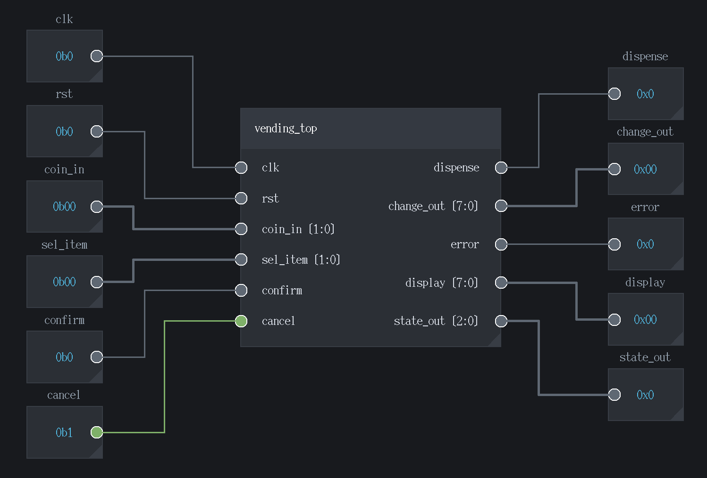
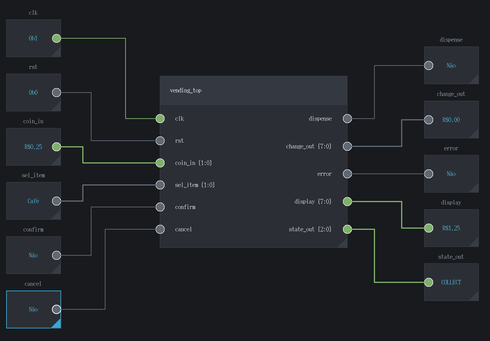

# RTL Explorer

RTL Explorer e uma ferramenta grafica em Tcl/Tk para abrir projetos Verilog/SystemVerilog, visualizar modulos como diagramas de blocos, analisar maquinas de estado e testar modulos sintetizaveis com simulacao interativa.

O objetivo do projeto e aproximar o fluxo de RTL de uma experiencia visual parecida com ferramentas como Logisim/Falstad, mas usando modulos reais em Verilog/SystemVerilog.

## Galeria

### Diagrama de blocos

O modo de blocos permite montar um circuito visualmente, conectar modulos do usuario, adicionar entradas, saidas, clock e acompanhar a simulacao direto no canvas.



### Mapeamento de valores

Entradas e saidas podem usar formatos binario, decimal ou hexadecimal. Tambem e possivel mapear valores para textos definidos pelo usuario, facilitando demonstracoes e depuracao.



### Maquinas de estado

O modo FSM detecta maquinas de estado no RTL, mostra transicoes, condicoes, loops inferidos e permite ajustar o desenho para apresentacao ou exportacao.


## Recursos principais

- Abre arquivos `.sv`, `.v` ou pastas completas de RTL.
- Salva e reabre projetos `.rtlex` com arquivos, blocos, conexoes, configuracoes e layout.
- Detecta modulos, portas, larguras de barramento, parametros simples e instancias nomeadas ou posicionais.
- Monta diagramas de blocos arrastaveis a partir dos modulos do usuario.
- Permite conexoes manuais, conexoes automaticas e conexoes por faixa de bits.
- Possui blocos internos para entrada, saida, clock, reset e constantes.
- Possui bloco LED em `Built-in blocks > Simulation I/O`, com cores azul,
  vermelho, verde, amarelo e branco. Use o botao direito no LED para escolher
  a cor e se ele acende com 1 ou com 0. O LED acompanha o sinal durante a
  simulacao; suas configuracoes sao salvas no projeto. A largura se adapta ao
  sinal conectado, com um LED por bit no mesmo retangulo (bit mais significativo
  a esquerda e bit 0 a direita). Use `Connection bit range` para observar apenas
  uma faixa do barramento.
- Possui bloco `switch` em `Built-in blocks > Simulation I/O`: clique na
  alavanca para alternar entre 0 e 1. Em barramentos, cada bit tem sua propria
  alavanca dentro do mesmo bloco. O estado e salvo no projeto e os cliques
  atualizam a entrada durante a simulacao. No menu do botao direito, use
  `Valor ao levantar` para escolher se a alavanca levantada envia 1 ou 0;
  a alavanca abaixada envia o valor oposto.
- Possui `push_button` em `Built-in blocks > Simulation I/O`, com um botao
  por bit e suporte a `Connection bit range`. O botao so fica acionado enquanto
  o mouse estiver pressionado; ao soltar, mesmo fora dele, volta ao repouso.
  No menu do botao direito, `Valor ao pressionar` escolhe entre enviar 1 ou 0;
  em repouso envia o valor oposto. Permite renomear, redimensionar e exibir a
  waveform, como o switch. A configuracao e salva com o botao em repouso.
- Possui `seven_segment_display` em `Built-in blocks > Simulation I/O`, um
  display com segmentos acesos vermelhos e apagados ocultos, com entrada
  `segments` fixa de 7 bits. Use a alca do canto para aumentar ou diminuir o
  display; largura e altura mudam juntas, preservando a proporcao dos segmentos. Os bits
  0 a 6 controlam os segmentos a, b, c, d, e, f e g, respectivamente: superior,
  superior direito, inferior direito, inferior, inferior esquerdo, superior
  esquerdo e central. Por exemplo, `0x3F` desenha 0 e `0x06` desenha 1 quando
  ativo em 1. No botao direito, escolha `Ativar segmentos com` 1 ou 0.
- Permite autoconectar blocos de entrada/saida aos modulos selecionados.
- Suporta nomes editaveis, formatos binario/decimal/hexadecimal e mapeamento de valores para texto.
- Mostra waveforms ao vivo no proprio modo de diagrama.
- Permite pausar, continuar, parar e executar simulacao pelo diagrama.
- Exporta diagramas de blocos e maquinas de estado para PDF.
- Detecta e desenha maquinas de estado a partir do codigo RTL.
- Permite mover estados, textos de transicao e ajustar visual da FSM.
- Suporta loops inferidos para transicoes implicitas de permanencia no mesmo estado.
- Tem instalador Windows offline e instalacao local no Linux sem precisar de sudo.

## Como executar

### Windows

Para usuario final, baixe e execute o instalador:

```text
RTL-Explorer-Setup.exe
```

O instalador inclui Tcl/Tk, Yosys, sv2v, Icarus Verilog e o compilador C++ usado pelo motor CXXRTL.

### Windows: executar o codigo baixado do GitHub

Em Windows 10/11 de 64 bits, extraia o ZIP do GitHub (ou clone o repositorio),
abra o PowerShell na pasta que contem este README e execute:

```powershell
powershell -NoProfile -ExecutionPolicy Bypass -File .\scripts\install-windows-dependencies.ps1
```

O script baixa Tcl/Tk 8.6.17, OSS CAD Suite 2026-07-05 (Yosys, Python,
Icarus Verilog e arquivos CXXRTL), sv2v 0.0.13 e w64devkit 2.8.0 (C++).
As ferramentas ficam em `.tools`, dentro do projeto, sem precisar configurar
o PATH global ou instalar Python separadamente. A instalacao precisa de internet
e varios GB livres; os downloads sao mantidos em `.tools/downloads` para reutilizacao.
O script pode ser executado novamente para completar uma instalacao interrompida.

Depois, abra o programa com duplo clique em `run-windows.cmd` ou execute:

```powershell
.\run-windows.cmd
```

O inicializador usa o Tcl/Tk local, mesmo que outra versao esteja no PATH.
Para conferir novamente as dependencias:

```powershell
.\.tools\tcl\bin\tclsh86.exe .\scripts\check-toolchain.tcl
```

Evite espacos no caminho do projeto: o Icarus Verilog para Windows pode falhar
ao chamar seus programas auxiliares quando o caminho da instalacao contem espacos.
Por exemplo, prefira `D:\RTL-Explorer`.

Se voce ja configurou todas as ferramentas manualmente, pode usar
`wish src/main.tcl` diretamente.

### Linux

Instalacao local, sem `sudo`:

```sh
make install
```

Depois execute pelo menu do sistema ou pelo terminal:

```sh
rtl-explorer
```

Para rodar direto do codigo, se `wish` estiver instalado:

```sh
wish src/main.tcl
```

## Gerar o instalador Windows

A partir da raiz do projeto:

```powershell
cd D:\RTL_EXP
powershell -ExecutionPolicy Bypass -File .\packaging\windows\build-installer.ps1
```

O instalador sera gerado em:

```text
dist\windows\RTL-Explorer-Setup.exe
```

Se as dependencias foram instaladas com `scripts/install-windows-dependencies.ps1`,
o empacotamento reutiliza automaticamente Tcl/Tk, OSS CAD Suite, sv2v e C++ da
pasta `.tools`. Nao e necessario baixa-los ou instalar Tcl/Tk novamente.
Altere `AppVersion` em `packaging/windows/rtl-explorer.iss` para definir a versao
exibida pelo instalador; isso nao altera a versao das dependencias.

Se ja houver ferramentas baixadas em `D:\RTL_EXP_tools`, use:

```powershell
powershell -ExecutionPolicy Bypass -File .\packaging\windows\build-installer.ps1 -ReuseLocalTools
```

## Fluxo basico de uso

1. Abra uma pasta ou arquivos com `File > Open Folder` ou `File > Open Files`.
2. Va para o modo `Blocos`.
3. Arraste modulos da biblioteca lateral para o canvas.
4. Conecte portas manualmente ou use `Auto Connect`.
5. Adicione blocos de entrada, saida e clock quando quiser simular.
6. Use `Build and Run` para sintetizar e iniciar a simulacao.
7. Use `Run`, `Pause`, `Stop` e `Step` para controlar a simulacao.
8. Ative `Waveforms` para acompanhar sinais em tempo real.
9. Ative `Lock blocks` na barra superior para bloquear o movimento e o
   redimensionamento dos componentes durante a simulacao. Switches, push buttons
   e entradas continuam funcionando. Clique novamente para liberar o layout.

## Simulacao

O RTL Explorer usa ferramentas externas para transformar o RTL em algo executavel:

- `sv2v`: converte SystemVerilog sintetizavel para Verilog quando necessario.
- `Yosys`: sintetiza o RTL e gera netlists.
- `CXXRTL`: motor padrao para modulos sintetizaveis.
- `Icarus Verilog`: motor alternativo para cenarios mais proximos de simulacao Verilog.
- Simulador Python interno: fallback simples para alguns circuitos pequenos.

O motor CXXRTL suporta clocks gerados internamente, por exemplo a saida `tick`
de um divisor conectada a `always @(posedge tick)` de outro modulo. A build
prepara esses clocks automaticamente, e a simulacao propaga as bordas ate o
circuito estabilizar, inclusive em cascata, sem alterar os arquivos Verilog.
O motor Python interno ainda nao suporta esse caso e orienta usar CXXRTL ou Icarus.

A simulacao principal foi pensada para o diagrama de blocos: o usuario conecta blocos de entrada, saida e clock ao modulo que deseja testar.

## Maquinas de estado

O modo `FSM` mostra maquinas de estado detectadas no codigo. Ao selecionar um modulo ou uma FSM no Explorer, o visualizador abre a maquina correspondente.

Recursos do modo FSM:

- Estados em formato circular.
- Transicoes curvas.
- Textos de condicao moviveis.
- Estado especial `ANY STATE` para transicoes globais, como reset.
- Opcao `Inferred Loops` para mostrar permanencia implicita no mesmo estado.
- Zoom e deslocamento do campo de visao.
- Exportacao para PDF.

## Estrutura do projeto

```text
assets/       Icones e recursos visuais.
dist/         Saida de builds e instaladores gerados.
images/       Prints usados no README e na apresentacao do projeto.
packaging/    Scripts de instalacao e empacotamento Windows/Linux.
sample/       Projetos e modulos pequenos para teste.
scripts/      Scripts auxiliares de verificacao.
src/          Codigo principal do RTL Explorer.
tests/        Testes automaticos.
```

Arquivos importantes em `src/`:

```text
main.tcl                  Entrada principal do programa.
layout.tcl                Janela, menus, abas e barra superior.
project_tree.tcl          Explorer lateral e biblioteca de blocos.
canvas_blocks.tcl         Desenho e interacao dos blocos.
canvas_connections.tcl    Fios, conexoes, snap e auto connect.
sv_parser.tcl             Leitura de Verilog/SystemVerilog.
fsm_viewer.tcl            Visualizador de maquinas de estado.
simulation_model.tcl      Preparacao de top modules e sintese.
simulation_backends.tcl   Motores de simulacao.
simulator_view.tcl        Tela e controles de simulacao.
pdf_export.tcl            Exportacao de diagramas para PDF.
toolchain.tcl             Localizacao das ferramentas externas.
```

## Samples

A pasta `sample/` contem exemplos simples para testar rapidamente:

- `adder.sv`: somador simples.
- `counter.sv`: contador com clock, reset e controle de direcao.
- `rs_flip_flop.sv`: flip-flop RS.
- `ula.sv`: ULA simples.

Para testar, use `File > Samples` ou `File > Open Folder` e selecione a pasta `sample`.

## Arquivos gerados

Durante build, simulacao ou empacotamento, algumas pastas podem ser criadas:

```text
.rtl_explorer_build/   Arquivos temporarios de sintese/simulacao.
.tools/                Ferramentas locais baixadas para desenvolvimento.
dist/                  Instaladores, downloads e staging de empacotamento.
```

Esses arquivos nao sao o codigo principal do programa.

## Licencas e terceiros

As ferramentas externas usadas no empacotamento estao documentadas em:

```text
packaging/THIRD_PARTY.md
```
